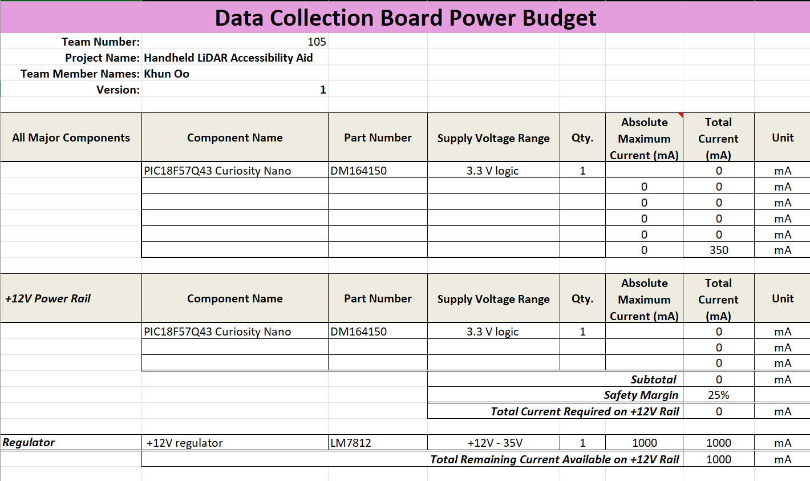
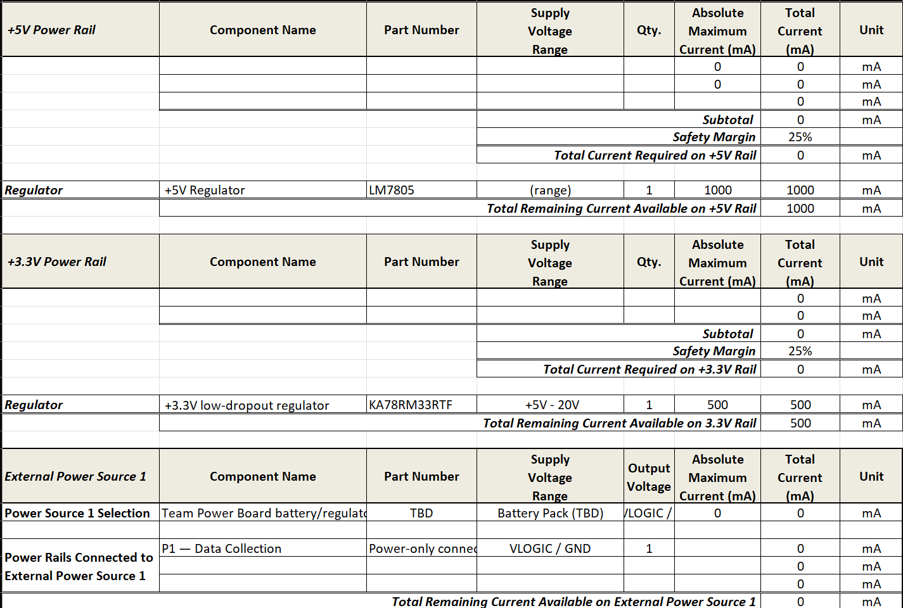
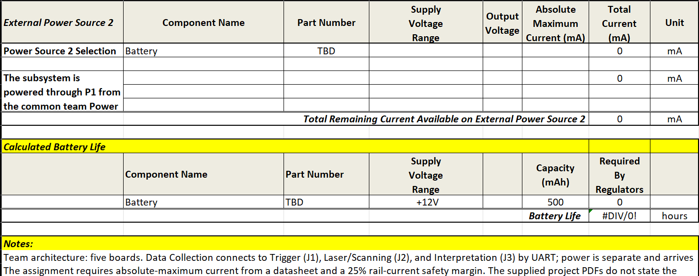

## Data Collection Board

**Team:** 105 — Phoenix Phorce  
**Project:** Handheld LiDAR Accessibility Aid  
**Member:** Khun Oo  
**Subsystem:** Data Collection Board  

## Overview

The Data Collection Board is responsible for coordinating LiDAR scan data, scan position information, and trigger information before sending the collected data to the Interpretation Board.

The current design uses a **PIC18F57Q43 Curiosity Nano** as the main microcontroller. The board communicates with the Trigger Board, Laser / Scanning Board, and Interpretation Board through UART connections.

The Data Collection Board receives power from the team Power Board through the **P1 power connection**. Power and communication are kept separate in the team architecture.

---
## Power Budget Analysis

The power budget for the Data Collection Board is summarized in the sections below, detailing major component current consumption, power rails, external source connections from the team Power Board, and calculated battery life.

### Part 1: Main Components and +12V Rail

### Part 2: +5V, +3.3V Rails, and External Power Source 1

### Part 3: External Power Source 2, Battery Life, and Notes

## Major Component Selection

### Microcontroller

**PIC18F57Q43 Curiosity Nano**

| Specification | Selection |
| --- | --- |
| Component | PIC18F57Q43 Curiosity Nano |
| Part Number | DM164150 |
| Quantity | 1 |
| Logic Level | 3.3 V |
| Communication | UART |
| Power Source | Team Power Board |
| Power Connection | P1 — VLOGIC / GND |

**Purpose:**  
The PIC18F57Q43 Curiosity Nano coordinates incoming trigger and scanning information, buffers collected scan samples, and communicates with the other embedded-system boards.

### Communication Connections

| Connector | Connected Board | Interface | Purpose |
| --- | --- | --- | --- |
| J1 | Trigger Board | UART TX/RX | Receives scan requests and trigger information |
| J2 | Laser / Scanning Board | UART TX/RX | Exchanges LiDAR and scanning information |
| J3 | Interpretation Board | UART TX/RX | Sends collected information for interpretation |

The Laser / Scanning Board documentation specifies **3.3 V UART signals** for the J2 connection to the Data Collection Board. Therefore, 3.3 V logic is currently used as a design assumption for the Data Collection Board.

> **Note:** The microcontroller was selected for the project and therefore does not require a three-option component-selection comparison. It is still included in the power budget because it consumes power.

---

## Power Architecture

The Data Collection Board does not contain its own battery or primary system power source. Power is supplied by the team's Power Board.

The Power Board contains the battery pack, protection and switching circuitry, voltage regulation, and power distribution circuitry.

The Data Collection Board receives power through:

- **P1 — VLOGIC**
- **P1 — GND**

The UART ribbon cables **J1, J2, and J3** are used for communication and are separate from the primary power connection.

### VLOGIC Power Rail

| Component | Part Number | Supply | Quantity | Maximum Current |
| --- | --- | --- | ---: | ---: |
| PIC18F57Q43 Curiosity Nano | DM164150 | 3.3 V logic | 1 | TBD |

A **25% safety margin** is applied to the total required current.

**Power budget calculation:**

`Required VLOGIC Current = Subtotal Current × 1.25`

The final absolute-maximum current is currently marked **TBD** because it must be supported by the appropriate component datasheet rather than estimated from a connector or regulator current rating.

---

## Power Source

| Specification | Current Selection |
| --- | --- |
| Source | Team Power Board |
| Connection | P1 |
| Rails | VLOGIC / GND |
| Local Battery | None |
| Local Primary Regulator | None currently specified |
| Available P1 Current | TBD |
| Final VLOGIC Voltage | TBD by team power design |

The team Power Board distributes dedicated power connections to each subsystem. **P1** is assigned to the Data Collection Board.

The final available current and finalized VLOGIC specification will be updated after the Power Board design is completed.

---

## Power Budget

The Data Collection Board power budget is provided below.

[**Download Data Collection Power Budget.xlsx**](https://github.com/Wanderer-Annoy/khunoo_RAS304_F26/raw/refs/heads/main/docs/Data%20Collection%20Power%20Budget.xlsx)

The power budget includes:

- Major powered components
- Component quantities
- Supply voltage
- Maximum current
- VLOGIC power rail
- 25% current safety margin
- Power Board P1 connection
- External power source information
- Remaining-current calculations

Values marked **TBD** will be updated as the schematic, component selections, and Power Board specifications are finalized.

---

## Design Notes

The current design keeps the Data Collection Board focused on data coordination. Its primary purpose is to receive, organize, buffer, and transmit information between the other embedded-system boards.

The LiDAR, scan motor, audio system, vibration motor, battery, and main voltage regulators belong to other team subsystems and therefore are not included as loads in the Data Collection Board power budget.

The current architecture will be updated as the PCB schematic, component selections, and final team power specifications are developed.
