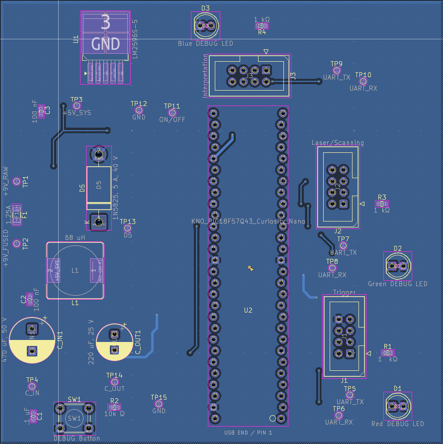
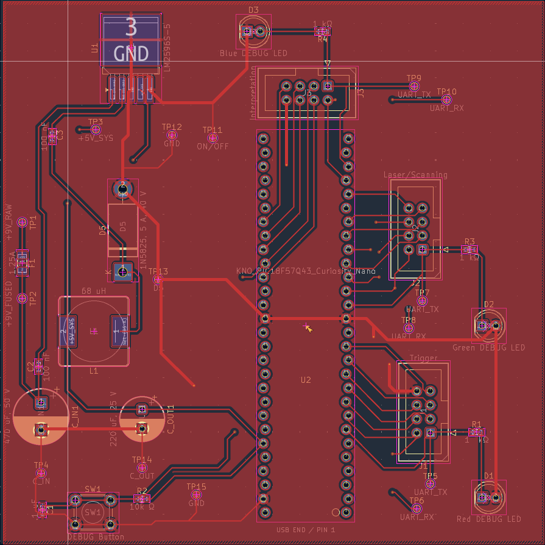
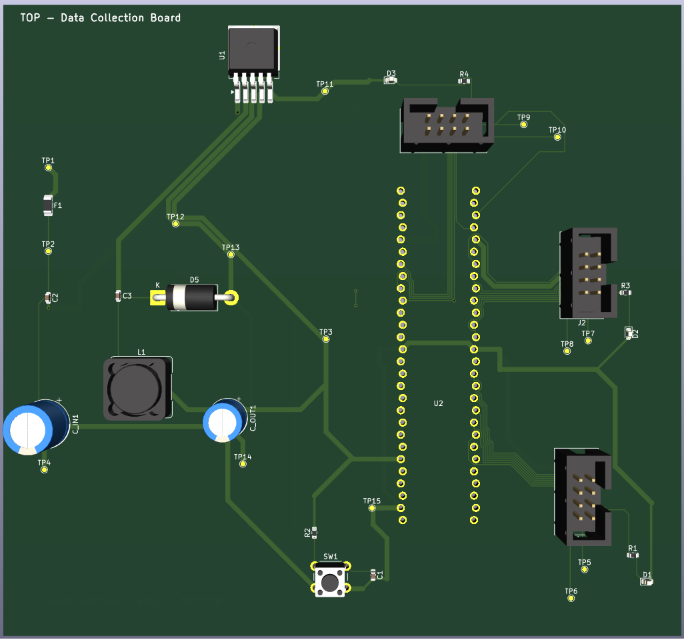
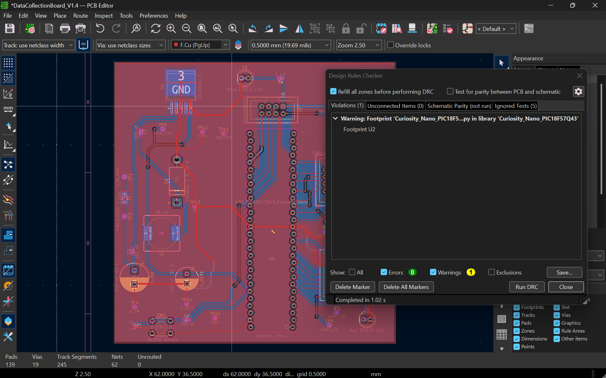
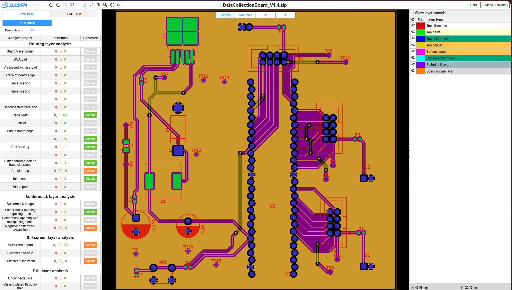

# PCB Design

## Overview

This page documents the PCB design, verification, and manufacturing files for the **Data Collection Board** developed for RAS 304 Embedded Systems.

The PCB was designed using **KiCad** and implements the finalized Data Collection subsystem schematic. The completed layout was verified using the KiCad Design Rules Checker (DRC) before generation of the manufacturing files.

---

## PCB Layout

**Figure 1. Final Data Collection Board PCB layout.**

---

## PCB 3D View

**Figure 2. 3D view of the completed Data Collection Board.**

---

## Design Verification

### KiCad Design Rules Check

The final PCB layout was verified using the **KiCad Design Rules Checker (DRC)**.

**Final DRC Result: 0 errors**

**Figure 3. KiCad DRC results for the final PCB.**

The DRC was used to verify the PCB for issues including:

- Short circuits
- Copper clearance violations
- Track-to-pad clearance
- Unconnected pads
- Track connectivity
- Board-edge clearance
- Solder-mask conflicts

The final PCB passed the required electrical design-rule checks before the manufacturing files were generated.

---

## Design for Manufacturing Check

The generated PCB manufacturing files were checked using **JLCDFM** before fabrication.

**Figure 4. JLCDFM PCB preview and DFM analysis.**

The JLCDFM check provides additional verification that the generated PCB manufacturing files can be successfully interpreted and fabricated.

---

## ECAD Project Files

The complete KiCad project is available below.

[**Download KiCad ECAD Project**](DataCollectionBoard_V1.4.zip)

The ECAD archive contains the editable KiCad project files for the Data Collection Board.

---

## Gerber Manufacturing Files

The final Gerber manufacturing package is available below.

<!-- Replace this filename with your actual Gerber ZIP filename. -->

[**Download Gerber Files**](OO_KHUN_GERBER.zip)

The Gerber package contains the PCB fabrication layers and drill information required for manufacturing.

